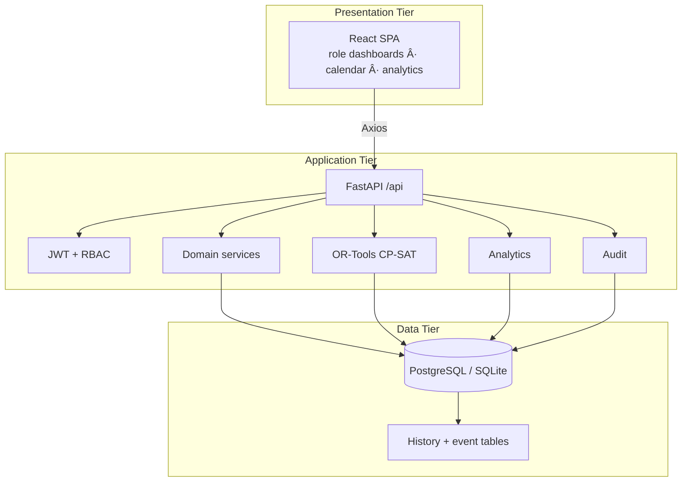
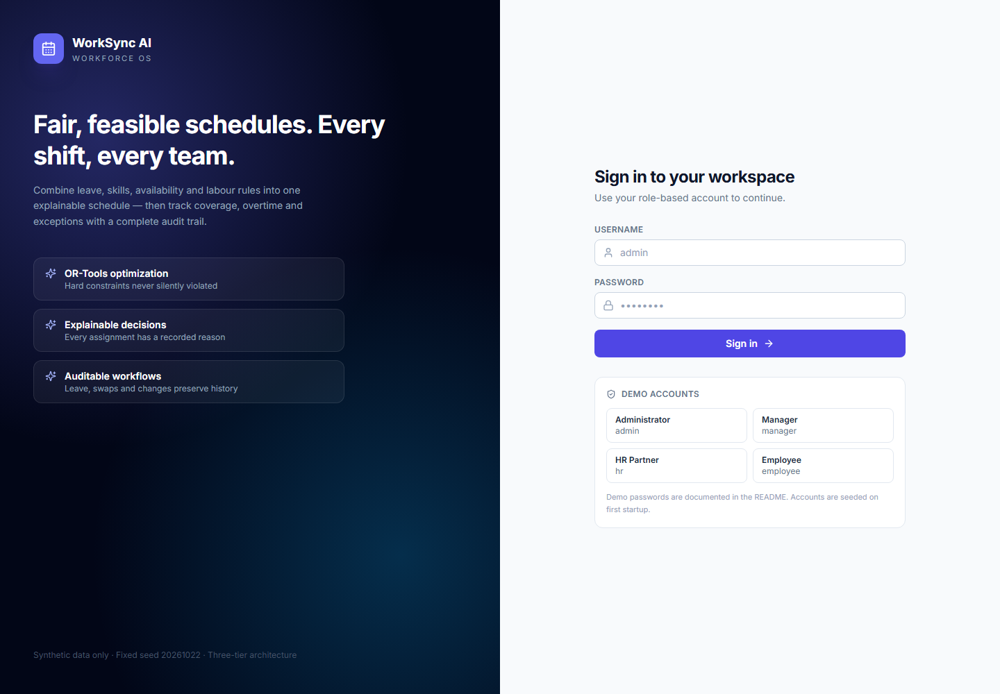
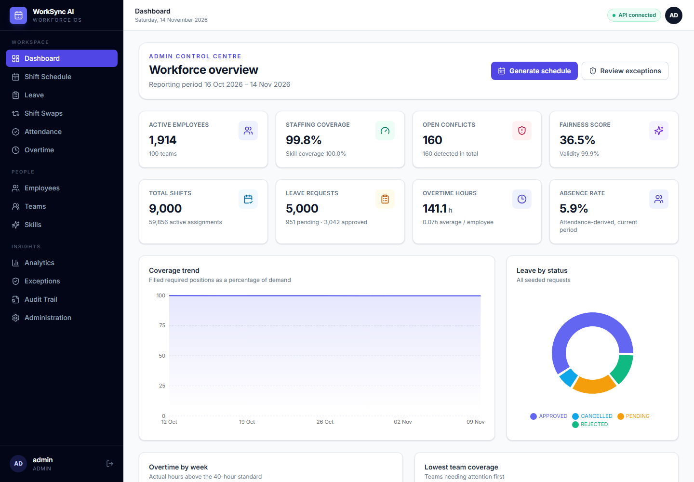
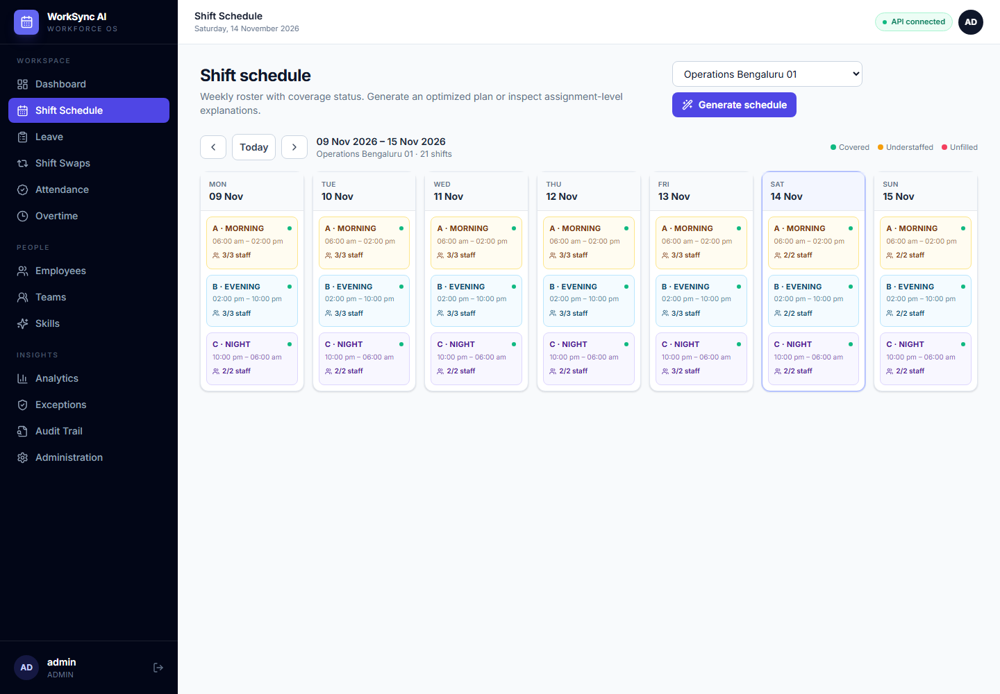
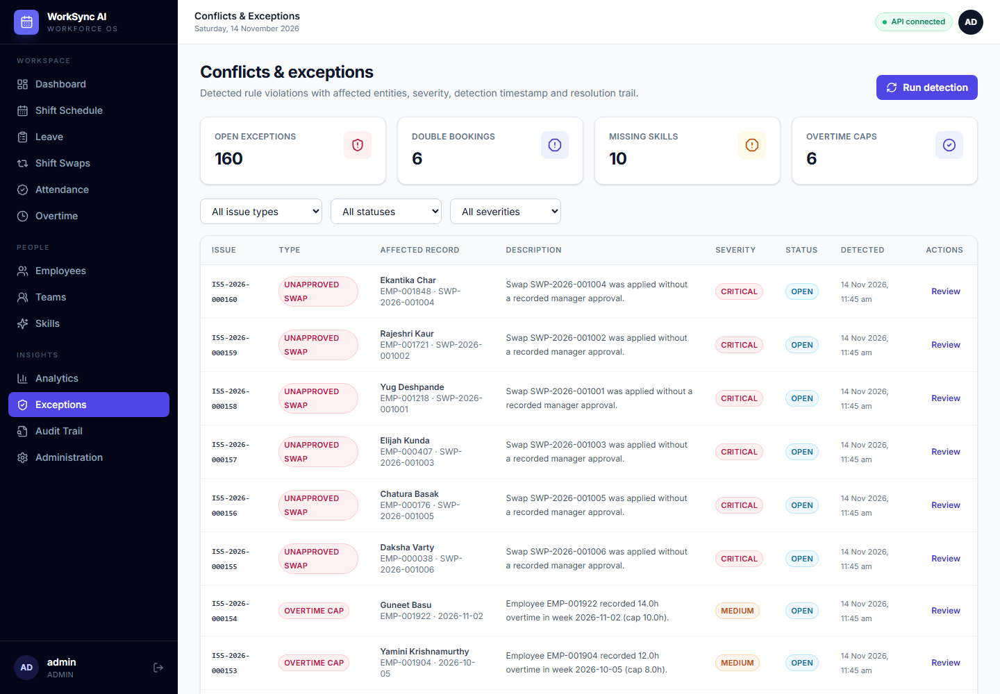
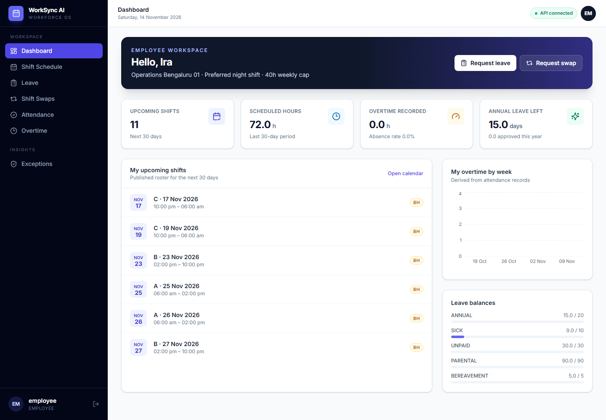

# WorkSync AI — Intelligent Workforce Scheduling & Leave Management

WorkSync AI is a complete, three-tier workforce-management application that
combines leave requests, shift coverage, employee skills, availability and labour
constraints into fair, feasible schedules. It exposes every scheduling decision,
preserves history, detects labelled exceptions and produces measurable
operational analytics.

> **Status:** full implementation, 25/25 automated tests passing, full synthetic
> dataset generated (2,000 employees / 100 teams / 27,000 shifts / 5,000 leave
> requests), detector precision and recall **100%** on 34 labelled anomalies,
> reproducibility **31/31 files byte-identical**.

---

## 1. Project overview

| Tier | Stack | What it does |
|---|---|---|
| Presentation | React 18, Vite, Tailwind, Recharts, React Router, Axios | Role-aware dashboards, calendar, leave/swap forms, charts, admin console |
| Application | FastAPI, SQLAlchemy, Pydantic, OR-Tools CP-SAT, JWT | Scheduling optimisation, leave/swap workflows, attendance/overtime, conflicts, analytics, audit |
| Data | PostgreSQL (Docker) / SQLite (local), Alembic | 25 normalised tables, FKs, indexes, history and event records |

The application is **not** a static dashboard: every statistic is calculated by
the backend from persisted records, the scheduler solves real CP-SAT models, and
all workflows enforce validated lifecycle rules.

## 2. Business problem

Manual scheduling has to reconcile approved leave, skill coverage, minimum
staffing, working-hour limits, overtime caps, rest periods, availability, shift
preferences, swaps and fairness. Spreadsheets silently violate constraints and
hide understaffing. WorkSync AI makes those constraints explicit, optimises the
roster, reports gaps instead of hiding them, and keeps an auditable trail.

## 3. Objectives

- Generate fair, feasible schedules with OR-Tools CP-SAT.
- Never silently violate a hard constraint; label partial/infeasible plans.
- Manage leave and swaps through approved lifecycle transitions.
- Record attendance and derive overtime from actual hours.
- Detect double-booking, leave overlap, missing skill, overtime-cap and
  unapproved-swap anomalies.
- Explain every assignment and preserve all historical states.
- Produce reproducible synthetic data, isolated ground truth and metrics.

## 4. Three-tier architecture

```
Browser / React SPA
        │  HTTPS /api
        â–¼
FastAPI application tier
  auth · leave · swaps · attendance · overtime · conflicts
  scheduling engine (OR-Tools CP-SAT) · analytics · audit
        │  SQLAlchemy
        â–¼
PostgreSQL (Docker) / SQLite (local)
  25 tables · PK/FK · indexes · event history
```

No frontend code touches the database; no backend code renders UI; the data tier
is reached only through SQLAlchemy sessions. See
[`docs/architecture.md`](docs/architecture.md).

## 5. Technology stack

**Backend:** Python 3.12/3.13, FastAPI 0.162, SQLAlchemy 2.1, Pydantic 2.14,
Alembic 1.20, OR-Tools 9.15 (CP-SAT), pandas/NumPy (generator), PyJWT, bcrypt,
psycopg 3.

**Frontend:** React 18.3, Vite 5.4, Tailwind CSS 3.4, Recharts 2.12, React Router
6.26, Axios 1.7, lucide-react.

**Data:** PostgreSQL 16 (Compose), SQLite (local fallback), Alembic migrations.

## 6. System architecture diagram



## 7. Database ER diagram

Full Mermaid model: [`docs/er_diagram.md`](docs/er_diagram.md).

Core relationships: Team 1:N Employee/Shift/CoverageRequirement; Employee N:M
Skill via `employee_skills`; Employee 1:N Leave/Assignment/Attendance; Shift 1:N
Assignment; Assignment 1:0..1 Attendance; Leave/Swap 1:N approval history;
SchedulingRun 1:N Decision/Exception.

## 8. Entity descriptions

| Entity | Description |
|---|---|
| Employee | Person record with team, employment type, caps, preferences and status |
| Team | Operational unit with department, site, headcount and effective-dated manager |
| Skill | Catalogue entry used in coverage requirements and swap validation |
| ShiftTemplate | A/B/C shift pattern with times and duration |
| Shift | Dated team instance of a template with required headcount |
| ShiftAssignment | Employee↔shift link with status/source and preserved history |
| LeaveRequest | Leave dates, type, reason, status and approval outcome |
| HolidayCalendar | Public holiday dates used for leave arithmetic and day type |
| AttendanceEvent | Scheduled vs actual check-in/out, derived hours/overtime |
| CoverageRequirement | Minimum headcount and per-skill minima by team/template/day type |
| SwapRequest | Requester/target assignments, agreements, approval and application |
| User / Role | Login account and ADMIN/HR/MANAGER/EMPLOYEE role |
| AuditLog | Append-only actor/action/entity/state/reason/timestamp |
| SchedulingRun/Decision/Exception | Run metadata, per-assignment explanation, detected issue |

## 9. Data dictionary

Complete field-level dictionary with types, required/optional, allowed values,
units, uniqueness and validation rules:
[`docs/data_dictionary.md`](docs/data_dictionary.md).

## 10. API documentation

Interactive Swagger UI: **`http://127.0.0.1:8000/docs`**; ReDoc:
`http://127.0.0.1:8000/redoc`; OpenAPI JSON: `/openapi.json`.

| Group | Endpoints |
|---|---|
| Auth | `POST /api/auth/login`, `POST /api/auth/register`, `GET /api/auth/me`, `POST /api/auth/change-password` |
| Employees | `GET/POST /api/employees`, `GET/PUT/DELETE /api/employees/{id}`, `PUT /api/employees/{id}/skills`, availability GET/POST |
| Teams | `GET/POST /api/teams`, `PUT /api/teams/{id}` |
| Skills | `GET/POST /api/skills` |
| Reference | `GET /api/shift-templates`, `GET /api/holidays`, `GET /api/leave-policies` |
| Leave | `GET/POST /api/leaves`, `GET /api/leaves/{id}`, `PUT /api/leaves/{id}/approve|reject|cancel`, `GET /api/leaves/balance/{employee}` |
| Scheduling | `POST /api/scheduling/generate`, `GET /api/scheduling/runs`, `GET /api/scheduling/runs/{id}`, `GET /api/scheduling/assignments`, `GET /api/scheduling/shifts` |
| Swaps | `GET/POST /api/swaps`, `GET /api/swaps/candidates`, `PUT /api/swaps/{id}/target-response|approve|reject|apply|cancel` |
| Attendance | `GET/POST /api/attendance`, `GET/PUT /api/attendance/{id}`, `GET /api/attendance/summary/{employee}`, `GET /api/attendance/overtime` |
| Exceptions | `GET /api/exceptions`, `GET /api/exceptions/{id}`, `PUT /api/exceptions/{id}/resolve`, `POST /api/exceptions/detect`, `GET /api/exceptions/summary` |
| Analytics | `GET /api/analytics/dashboard|coverage|overtime|fairness|leave|trends|me` |
| Audit / Admin | `GET /api/audit`, `GET/POST/PUT /api/admin/users`, `/admin/roles`, `/admin/config`, `/admin/validation` |

All list responses use `{items, total, page, page_size, pages}`. Errors use
`{error:{code,message,details}, detail}` with appropriate HTTP status. Bearer JWT
is required except for login/register/health.

## 11. Scheduling algorithm

`backend/app/scheduling/engine.py` builds a CP-SAT model per team/horizon.

**Decision variables:** `x[employee, shift]` (assignment), `y[employee, shift,
skill]` (qualified skill fill), overtime and fairness variables.

**Hard constraints:** non-overlap; approved leave exclusion; team/status
eligibility; availability; skill qualification; minimum rest; weekly cap +
overtime allowance; coverage and skill minima where feasible.

**Soft objective:** minimise overtime, flatten night/evening/morning counts,
reward preferences, minimise unnecessary overstaffing.

If the hard model is infeasible, coverage is relaxed and the engine returns a
`PARTIAL` plan with explicit `CoverageGap` records. It never reports an invalid
plan as valid. Each assignment produces a `SchedulingDecision` with a
human-readable reason and structured constraint evaluation.

## 12. Business rules

Detailed rules for leave, swaps, attendance, overtime, coverage, conflict
detection, security and history are in
[`docs/business_rules.md`](docs/business_rules.md).

Highlights: `PENDING → APPROVED/REJECTED/CANCELLED` leave;
`REQUESTED → APPROVED → APPLIED` swaps with target agreement; approved leave
blocks scheduling; swaps re-validate skills/availability/hours/rest; assignment
and approval history is never overwritten.

## 13. Anomaly detection

The runtime detector (`backend/app/services/conflict_service.py`) finds:

- `DOUBLE_BOOKING` — overlapping active assignments for one employee
- `LEAVE_OVERLAP` — assignment during approved leave
- `MISSING_SKILL` — qualified headcount below a skill minimum
- `OVERTIME_CAP` — weekly attendance overtime above the employee cap
- `UNAPPROVED_SWAP` — `APPLIED` swap with no `APPROVED` event
- plus `COVERAGE_GAP`, `REST_VIOLATION`, `HOURS_CAP`, `ATTENDANCE_MISMATCH`

Every issue has an ID, type, affected entity IDs, severity, description,
detection timestamp, source, fingerprint and resolution state. Detection does
**not** read ground truth.

## 14. Ground-truth methodology

Valid baseline first, then six instances of each required anomaly (34 labelled
rows in the full dataset), with labels stored only in `ground_truth/`. The
evaluation script joins detector output to labels by documented entity keys. See
[`docs/ground_truth.md`](docs/ground_truth.md).

## 15. Evaluation metrics

Coverage, skill coverage, schedule validity, fairness (normalised coefficient of
variation across night/weekend/overtime), overtime, absence rate and detector
precision/recall/F1. Full definitions and results:
[`docs/evaluation.md`](docs/evaluation.md) and
[`docs/evaluation_results.md`](docs/evaluation_results.md).

**Full dataset:** 34/34 anomalies found, precision 100%, recall 100%, F1 100%.
**Reproducibility:** 31/31 files byte-identical across two full runs.

---

## 16. Installation

### Option A — local (SQLite, no Docker required)

Prerequisite: Python 3.12+ and Node 18+.

```powershell
cd WorkSyncAI

# Backend
python -m venv .venv
.\.venv\Scripts\Activate.ps1
cd backend
pip install -r requirements-dev.txt
cd ..

# Frontend
cd frontend
npm install
cd ..
```

**Build note:** the presentation tier can run with the standard Vite dev server
(`npm run dev`). Production `npm run build` uses a Rollup bundle (`build:vite`
is available for a conventional Vite build). This keeps the build reproducible
in restricted Windows sandboxes where esbuild's helper process cannot be
spawned; the generated SPA is the same React application.

The full generated dataset is already included. On first backend startup, if the
database is empty and the CSV seed is present, WorkSync AI loads it automatically
(disable with `AUTO_SEED_DEMO_DATA=false`). You can also load it explicitly or
regenerate it:

```powershell
$env:PYTHONPATH="backend"
python -m data_generation.generate_data --scale full
cd backend
python -m app.seed.load_seed --scale full
```

### Option B — Docker Compose (PostgreSQL)

Prerequisite: Docker Desktop / Docker Engine with Compose.

```bash
cd WorkSyncAI
docker compose up --build
```

Compose starts PostgreSQL, runs Alembic migrations and the seed loader, starts
FastAPI, builds the React bundle, and serves it through nginx with `/api`
proxying. URLs: frontend `http://localhost:3000`, API docs
`http://localhost:8000/docs`.

## 17. Execution commands

| Task | Command |
|---|---|
| Start backend (local) | `cd backend; ..\.venv\Scripts\python -m uvicorn app.main:app --reload --port 8000` |
| Start frontend dev server | `cd frontend; npm run dev` → `http://127.0.0.1:5173` |
| Build frontend (production) | `cd frontend; npm run build` → `dist/` |
| Preview built frontend + API proxy | `cd frontend; npm start` → `http://127.0.0.1:4173` |
| Generate full data | `python -m data_generation.generate_data --scale full` |
| Generate starter data | `python -m data_generation.generate_data --scale starter` |
| Load seed CSVs | `cd backend; python -m app.seed.load_seed --scale full` |
| Alembic migrate | `cd backend; python -m alembic upgrade head` |
| Reproducibility proof | `python -m data_generation.reproducibility` |
| Detector evaluation | `cd backend; python -m app.validation.evaluate_detection` |
| Run tests | `pytest tests -q` |
| Docker | `docker compose up --build` |

**Local startup (two terminals):**

```powershell
# terminal 1
cd backend
..\.venv\Scripts\python -m uvicorn app.main:app --reload --port 8000

# terminal 2
cd frontend
npm run dev
```

Demo accounts (seeded on first start):

| Username | Password | Role |
|---|---|---|
| `admin` | `Admin@123` | ADMIN |
| `hr` | `Hr@12345` | HR |
| `manager` | `Manager@123` | MANAGER |
| `employee` | `Employee@123` | EMPLOYEE |

## 18. Sample screenshots

Screenshots of the running application are stored under `docs/screenshots/`:











The UI includes all 15 required modules: authentication, dashboard, employees,
teams, skills, leave, scheduling calendar, automated generation, swaps,
attendance, overtime, conflicts, analytics, audit and administration.

## 19. Testing

```powershell
cd WorkSyncAI
pytest tests -q
```

Latest result: **25 passed**. Tests cover authentication/RBAC, employee/team
scoping, leave lifecycle and overlap, scheduling with approved leave, decision
explanations, infeasibility gaps, swap target agreement/approval/application,
refusal of unapproved application, attendance reconciliation, overtime summary,
all five anomaly detections, analytics and admin validation.

Data validation is separate:

```powershell
python -m data_generation.generate_data --scale full   # prints validation JSON
python -m data_generation.reproducibility
cd backend; python -m app.validation.evaluate_detection
```

## 20. Limitations and future enhancements

- The included environment has no Docker/PostgreSQL installed, so Compose was
  statically configured and the SQLite fallback was used for end-to-end
  verification. The schema/migration are PostgreSQL-compatible.
- Full-dataset scheduling defaults to a team/horizon scope; all-team optimisation
  is intentionally bounded by a time limit because the problem is NP-hard.
- The solver optimises one team at a time; cross-team pooling with shared
  employees would need a larger model or decomposition strategy.
- Shift swaps are validated at approval/apply time; a background checker is
  available through `/api/exceptions/detect` rather than a scheduled job.
- Email/SMS notifications, payroll export, demand forecasting and mobile apps
  are future work.
- Synthetic data only; no real employee or personal data is included.

---

## Project structure

```text
WorkSyncAI/
├── AI_USAGE.md                AI usage disclosure and prompt history
├── frontend/                 React + Vite + Tailwind presentation tier
│   ├── src/components/       Layout, tables, modals, charts, badges
│   ├── src/pages/            15 role-aware modules
│   ├── src/services/         Axios API client + JWT interceptor
│   ├── src/context/          Auth provider
│   └── server.mjs            static preview + /api proxy
├── backend/
│   ├── app/api/               REST routers + RBAC dependencies
│   ├── app/services/          business logic + analytics + detection
│   ├── app/scheduling/        OR-Tools CP-SAT engine
│   ├── app/models/            25 SQLAlchemy entities
│   ├── app/schemas/           Pydantic contracts
│   ├── app/validation/        dataset checks + detector evaluation
│   ├── app/seed/              bootstrap + CSV loader
│   ├── migrations/            Alembic revision
│   └── requirements*.txt
├── database/
│   ├── schema.sql             PostgreSQL DDL generated from metadata
│   ├── seed_master.sql        master-data SQL seed
│   └── seed/full|csv|json|ground_truth, starter/
├── data_generation/           deterministic generator, validators, injector,
│                              reproducibility proof
├── ground_truth/              isolated labels (CSV + JSON)
├── tests/                     pytest suite (25 tests)
├── docs/                      architecture, ER, data dictionary, rules,
│                              evaluation, validation, reproducibility, manifest
├── docker-compose.yml
├── .env.example
└── README.md
```

## Dataset and reproducibility

- Fixed seed: **20261022**
- Window: **2026-10-01 → 2026-12-29**, as-of **2026-11-14**
- Scale: **2,000 employees · 100 teams · 90 days · 5,000 leave requests**
- Row total: **159,140** across 25 tables
- Generated outputs: CSV for every table, master JSON, PostgreSQL schema,
  master SQL seed, manifest with SHA-256 checksums, validation summary.
- Two full generations produced **31/31 byte-identical deliverable files**
  (see [`docs/reproducibility.md`](docs/reproducibility.md)).

## Documentation index

- [Architecture](docs/architecture.md)
- [ER diagram](docs/er_diagram.md)
- [Data dictionary](docs/data_dictionary.md)
- [Business rules](docs/business_rules.md)
- [Evaluation methodology](docs/evaluation.md)
- [Evaluation results](docs/evaluation_results.md)
- [Ground truth](docs/ground_truth.md)
- [Validation summary](docs/validation_summary.md)
- [Reproducibility](docs/reproducibility.md)
- [AI usage disclosure & prompt history](AI_USAGE.md)
- [Source manifest](docs/source_manifest.json)

