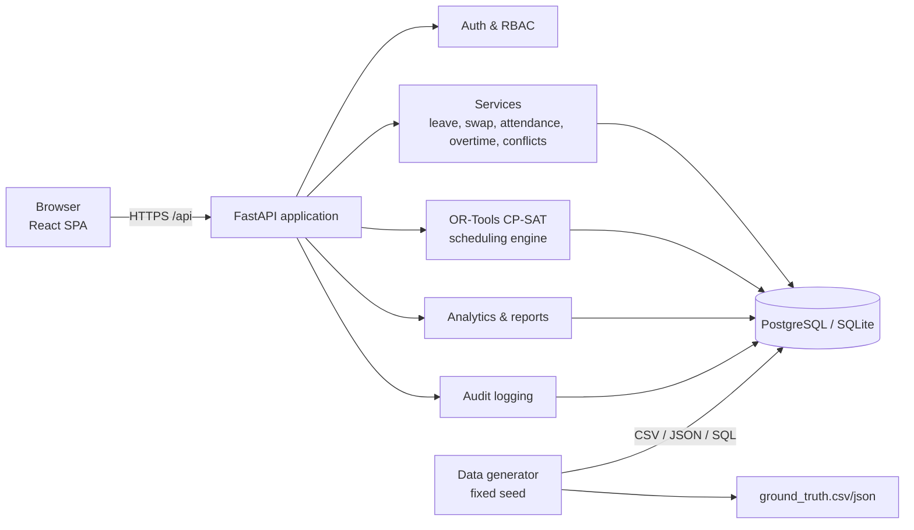

# WorkSync AI architecture

## Three-tier separation

WorkSync AI is a strict three-tier application. No tier imports another tier's
responsibility directly:

| Tier | Technology | Responsibility | Location |
|---|---|---|---|
| Presentation | React 18, Vite, Tailwind CSS, Recharts, React Router, Axios | Role-aware dashboards, calendar, forms, charts, client validation | `frontend/` |
| Application | Python 3, FastAPI, SQLAlchemy, Pydantic, Google OR-Tools CP-SAT, JWT | Business rules, workflows, scheduling optimisation, analytics, validation, audit | `backend/app/` |
| Data | PostgreSQL (Docker) / SQLite (local fallback), SQLAlchemy ORM, Alembic | Persistent entities, keys, constraints, indexes, history | `backend/app/models/`, `database/`, `backend/migrations/` |

The browser never talks to the database. FastAPI never renders HTML. The data
tier is accessed only through SQLAlchemy sessions/repositories. The synthetic
data generator is an offline data-engineering pipeline that writes CSV/JSON/SQL
and can load the data tier.

## Runtime topology

## Application-tier modules

- `api/` — HTTP routers, dependencies, RBAC, pagination, error envelopes
- `services/` — leave, swap, attendance, overtime, conflict, analytics, scheduling, validation
- `scheduling/` — pure OR-Tools CP-SAT engine (context objects in, plan out)
- `analytics/` — metric definitions
- `validation/` — dataset checks and detector evaluation
- `audit/` — append-only audit writer
- `core/` — settings, security, ID counters, workforce/time helpers
- `models/` — SQLAlchemy ORM (25 tables)
- `schemas/` — Pydantic request/response contracts
- `seed/` — idempotent bootstrap and CSV loader

## Scheduling flow

1. Manager selects a team and date horizon.
2. `SchedulingService` creates a `SchedulingRun` (`RUN-YYYY-NNNNNN`).
3. `scheduling/engine.py` loads per-team context: active employees, skills,
   availability, approved leave, existing assignments, coverage requirements.
4. The CP-SAT model enforces hard constraints:
   - one non-overlapping assignment per employee
   - minimum rest between shifts
   - no assignment during approved leave
   - team eligibility
   - availability windows
   - weekly hour cap + overtime allowance
   - coverage and skill minima where feasible
5. The objective minimises overtime and unfair night/evening concentration,
   rewards preferences, and keeps staffing close to requirement.
6. If the hard-coverage model is infeasible, the engine re-solves with coverage
   as a penalty, marks the run `PARTIAL`, and reports explicit gaps. It never
   reports an invalid plan as valid.
7. Assignments (`ASG-*`) and `SchedulingDecision` rows record the reason, skill
   match, availability/leave checks, constraint evaluation and score.
8. Gap/missing-skill exceptions are persisted with issue IDs; the audit log
   records the run.

## Leave flow

`PENDING → APPROVED / REJECTED / CANCELLED`

Submission validates employee, policy, dates, working days, maximum
consecutive days, notice, annual balance and overlapping requests. Every
decision appends `LeaveApprovalHistory`; approved leave is excluded by the
scheduler and reported as `LEAVE_OVERLAP` if an assignment already exists.

## Swap flow

`REQUESTED → APPROVED / REJECTED / CANCELLED → APPLIED`

Target agreement is required. Manager approval re-validates both employees for
skills, leave, availability, weekly hours and rest. Application preserves the
old assignments as `SWAPPED_OUT` and creates new `SWAPPED_IN` assignments;
`SwapApprovalHistory` records every transition. Applying without an `APPROVED`
event is rejected by the service and detected as `UNAPPROVED_SWAP` if it appears
through a data anomaly.

## Failure and exception paths

- Infeasible schedule → `PARTIAL`/`INFEASIBLE` run plus coverage-gap exceptions.
- Invalid leave/swap transition → HTTP 409 with a domain error code.
- Missing/invalid token → HTTP 401; insufficient role/team access → HTTP 403.
- Request validation → HTTP 422 with structured details.
- Unhandled error → HTTP 500, logged, generic message (no secret leakage).
- Detected conflicts → `SchedulingException` rows with severity, affected
  entities, detection source, resolution status and audit trail.

## Data-tier conventions

- Every entity has a primary key; all relationships have foreign keys.
- Many-to-many uses `employee_skills`; effective-dated relationships use
  `employee_availability`, `team_managers` and coverage versions.
- Lifecycle state is stored on the entity and every transition is appended to a
  history table; rows are soft-cancelled, never deleted.
- `created_at` / `updated_at` are present where mutable.
- Indexes cover common filters: employee, team, shift date, status, issue type.
- SQLite has `PRAGMA foreign_keys=ON`; PostgreSQL uses real constraints.
- Bulk loading uses one transaction per table and parent-first order.

## Deployment

- Local: SQLite + uvicorn + Rollup-built SPA (or Vite dev server).
- Docker Compose: PostgreSQL 16, FastAPI container running Alembic + seed
  loader, nginx serving the React bundle and proxying `/api`.
- Health endpoints: `/api/health` for both backend and Compose healthcheck.
