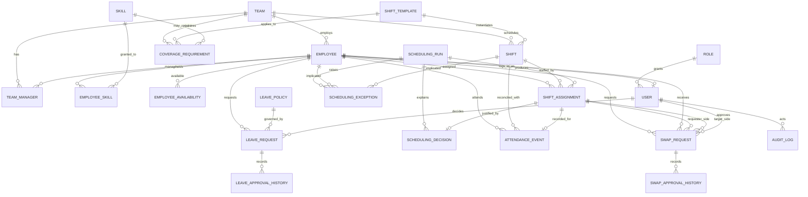

# Entity-relationship model

## Cardinality summary

| Relationship | Cardinality | Optional? | Notes |
|---|---|---|---|
| Team → Employee | 1:N | No | An employee belongs to exactly one team; team transfer is a state change on the employee. |
| Team ↔ Employee (manager) | N:M over time | Yes | `team_managers` is effective-dated and keeps prior managers. |
| Team → Shift | 1:N | No | Shift is a dated instance per team/template. |
| ShiftTemplate → Shift | 1:N | No | Three templates (A/B/C). |
| Employee ↔ Skill | N:M | Yes | Bridge `employee_skills` with proficiency/certification. |
| Team/Skill/Template → CoverageRequirement | 1:N | No | Skill may be NULL for overall headcount. |
| Employee → LeaveRequest | 1:N | Yes | Approved leave blocks assignment. |
| LeaveRequest → LeaveApprovalHistory | 1:N | No | Append-only lifecycle. |
| Shift → ShiftAssignment | 1:N | Yes | One row per employee assigned to the shift. |
| Employee → ShiftAssignment | 1:N | Yes | History retained when swapped/cancelled. |
| ShiftAssignment → AttendanceEvent | 1:0..1 | Yes | One attendance event per assignment. |
| Employee → AttendanceEvent | 1:N | Yes | Attendance reconciles to assignment/shift. |
| Employee → SwapRequest | 1:N (two roles) | Yes | Requester and target are distinct employees. |
| SwapRequest → SwapApprovalHistory | 1:N | No | Requested/agreed/approved/rejected/applied. |
| SchedulingRun → SchedulingDecision | 1:N | No | One explanation per generated assignment. |
| SchedulingException | independent event | — | References employee/shift/assignment/transaction; issue ID immutable. |
| Role → User | 1:N | No | ADMIN, HR, MANAGER, EMPLOYEE. |
| User → AuditLog | 1:N | Yes | Actor is nullable for system/seed events. |

## Key lifecycle states

- Employee: `ACTIVE`, `ON_LEAVE`, `INACTIVE`, `TERMINATED`
- Shift: `PLANNED`, `PUBLISHED`, `COMPLETED`, `CANCELLED`
- Shift assignment: `SCHEDULED`, `CONFIRMED`, `COMPLETED`, `CANCELLED`, `SWAPPED_OUT`, `SWAPPED_IN`, `NO_SHOW`
- Leave: `PENDING`, `APPROVED`, `REJECTED`, `CANCELLED`
- Swap: `REQUESTED`, `APPROVED`, `REJECTED`, `CANCELLED`, `APPLIED`
- Attendance: `PRESENT`, `LATE`, `ABSENT`, `EARLY_DEPARTURE`, `NO_SHOW`, `ON_LEAVE`
- Scheduling run: `RUNNING`, `COMPLETED`, `PARTIAL`, `INFEASIBLE`, `FAILED`
- Exception: `OPEN`, `ACKNOWLEDGED`, `RESOLVED`, `IGNORED`

## Indexes and constraints

- PK on every table; FK constraints on every relationship.
- Unique: employee email, team name, skill name, shift (team/date/template),
  leave/swap IDs, holiday (date/region), role name, username/email, assignment
  attribution for attendance, scheduling exception fingerprint.
- Indexes on employee/team/shift date, assignment status, leave status/date,
  exception type/status, audit entity/date, run status.
- A cancelled or swapped-out assignment remains in the table; active duplicate
  checks are enforced by services and validation.
